# Hermes Model Leaderboard

A **LLM comparison dashboard** plugin for [Hermes Desktop](https://hermes-agent.nousresearch.com): compare, score and rank LLM models as a full-page `/model-leaderboard` route — prices, benchmarks and OpenRouter news, no configuration needed.

Ported from the reference app `sumaris-agent/docker/llm-dashboard` (live at `http://localhost:3004/`), **first tab only**: authentication, dark-mode toggle and the consumption tab are intentionally out of scope — Hermes Desktop already provides the identity (the plugin runs inside the authenticated desktop context) and the theme (via the standard CSS variables).

## Install

```bash
hermes plugins install e-is/hermes-model-leaderboard --force
hermes plugins enable model-leaderboard
hermes gateway restart
```

Then reload the desktop window (F5 / Cmd+R): **Model Leaderboard** appears in the sidebar.

Notes — the three things that trip people up:

- **`--force` is expected.** The install scanner rates any community plugin `CAUTION`
  (bundled React/recharts regexes read as "obfuscation", `localStorage` as "persistence").
  The verdict is `CAUTION`, not `DANGEROUS`, so `--force` applies — there is no CRITICAL
  finding to accept. Two findings were real enough to fix in the build instead:
  a `SECRET_DO_NOT_PASS_THIS_OR_YOU_WILL_BE_FIRED` string inside bundled prop-types
  (now split by `scripts/build.mjs`) and a zero-width joiner in an emoji.
- **The plugin key is `model-leaderboard`** (from `plugin.yaml`), *not* the repository
  name `hermes-model-leaderboard`. `hermes plugins enable hermes-model-leaderboard`
  will not match. Likewise `dashboard/manifest.json` must carry the **same** `name`:
  `plugin.yaml` decides the namespace the renderer's `ctx.rest` scopes to, while the
  manifest decides the path the gateway mounts the router under. A mismatch 404s every
  API call (`No such API endpoint: /api/plugins/model-leaderboard/...`).
- **The desktop needs its own toggle.** A plugin coming from `~/.hermes/plugins/` ships
  *disabled* in Hermes Desktop until you switch it on in **Settings → Plugins**. That
  choice is stored per renderer id: if you enabled an earlier build published as
  `hermes-model-leaderboard`, the `model-leaderboard` renderer is a new id and starts
  off again — no sidebar entry, no page. Enable it once more.
- **`enable` asks about built-in tool override** — "Allow this plugin to replace built-in
  tools (e.g. shell_exec, write_file)?". Answer **no**: this plugin registers no agent
  tools at all (it ships a dashboard API router, a desktop renderer and a read-only
  skill), so the prompt is not applicable. To skip it:
  `hermes plugins enable model-leaderboard --no-allow-tool-override`.

**First run** seeds the tracked-model list from the main model declared by each installed
Hermes profile (`default` first), then persists it to `dashboard/data/models.json`. Delete
that file to re-seed.

## Features

- 📊 **Model comparison** — context window, input/output/cache prices, Artificial Analysis indices (intelligence, coding, agentic), an SWE-bench Verified column, vision/tools support, open-weights, local VRAM estimate.
- ⭐ **Per-profile scoring** — one chip per **Hermes profile** (and `default`), 0–5 weights on 11 criteria, instant re-ranking + top-5 cards. A profile with no saved criteria starts from a sane default (intelligence 5, price 3, rest 0).
- 📈 **Six score views** — Cards, Score bars (points earned per criterion), Histograms (grade × weight), Heatmap (grade 0–100, heaviest criteria first; click a cell to enter a real value), Duel (two models, criterion by criterion), and **Quality / cost**: a scatter with the weighted cost on a log axis, the quality on the other, and the **Pareto frontier** dashed through the best trade-offs. Each grade says where it came from — OpenRouter, an estimate fitted on the other models, or a value you typed.
- 🤖 **Auto-fill** — a button in the criteria dialog asks Hermes' own LLM (`ctx.llm.complete_structured`, the model the user is already running — no subprocess, no API key in the plugin) to propose weights for that profile; the answer is validated against a JSON schema. Never automatic, always user-triggered.
- 🧠 **Shipped skill** — `skill_view('model-leaderboard:refresh-benchmarks')` walks an agent through refreshing the hand-curated benchmark indices (SWE-bench Verified, LiveCodeBench) from the public leaderboards and writing them back. Read-only, loaded on demand.
- 🔎 **Search** — filters the tracked table live *and* queries OpenRouter for untracked models (checkbox to opt out), with a one-click add.
- 📰 **OpenRouter news** — side panel: promotions (with end dates), price changes (rolling 1 d / 7 d, configurable threshold), new models (sort by date or score, +1-week pagination).
- 🛡️ **Resilience** — 5 min OpenRouter cache, stale-on-error fallback on 429s, plus a visibility-gated auto-pull (cheap local poll every 60 s, real refetch every 10 min — only while the page is visible).
- 🧭 **Native desktop UX** — deletion confirms through the desktop's own `ConfirmDialog` (imported from the plugin SDK), tooltips and labels fully i18n'd (en/fr), styling left to the app's CSS variables.
- 🔑 **No auth plumbing** — profiles always persist backend-side; the desktop supplies identity.

## Architecture (unified Hermes plugin)

Same conventions as [hermes-kanban-gantt](https://github.com/e-is/hermes-kanban-gantt):

| Reference (docker/llm-dashboard) | This repo |
|:---|:---|
| `backend/main.py` (FastAPI :3004, `/api/*`) | `dashboard/plugin_api.py` — FastAPI **router** mounted at `/api/plugins/model-leaderboard/` |
| `backend/data/*.json` | `dashboard/data/` (shipped seed data + runtime state) |
| `frontend/src/App.tsx` + components (React 18, Recharts) | `src/` (TSX) → esbuild → `desktop/plugin.js` (artifact committed, SDK/react external, Recharts bundled) |

```
plugin.yaml          unified plugin manifest  (name: model-leaderboard)
plugin_ctx.py        host context (ctx.llm, …) shared with the standalone router
__init__.py          register(): publishes ctx.llm + the shipped skills
dashboard/           backend — FastAPI router → /api/plugins/model-leaderboard/
  manifest.json      name/label/version/api pointer  (name must equal plugin.yaml's)
  data/              seed: models, benchmarks
skills/              read-only skills → skill_view('model-leaderboard:<name>')
                     runtime (gitignored): openrouter cache, price history
desktop/             BUILD ARTIFACT — renderer loaded uncompiled
src/                 TSX authoring sources (esbuild → desktop/plugin.js)
  core/scoring.ts    pure scoring helpers (unit-tested)
  components/        NewsPanel
  hooks/             useResizable
tests/               pytest backend suite + node unit tests (scoring, path guards)
assets/              screenshots + animations/ + catalogue cards (scripts/shots.py, card.py)
```

## Build & test

```bash
npm install
npm run build                                      # src/ → desktop/plugin.js
node --experimental-strip-types --test "tests/unit/*.test.ts"   # scoring + path guards
pytest tests/test_backend.py -q                    # backend
npm test                                           # both
```

To iterate without reinstalling: copy `desktop/plugin.js` into
`~/.hermes/plugins/model-leaderboard/desktop/` and reload the desktop window. Remove
`~/.hermes/desktop-plugins/model-leaderboard` if the loader keeps serving the previous
artifact (the lift aborts with `EEXIST` when that folder already exists — a runtime
bug, not a plugin one).

## Data sources

| Data | Source | Refresh |
|:---|:---|:---|
| Prices, context, modalities, AA indices | OpenRouter `GET /api/v1/models` | auto (5 min cache) |
| News: promos, price changes, new models | derived from the same cache + local price history | auto |
| SWE-bench Verified | **curated** in `dashboard/data/benchmarks.json` | manual |

(The multilingual-coverage criterion was removed: OpenRouter exposes no language field and HF
`cardData.language` is empty for current models — see the roadmap below.)

Why the benchmark columns are curated rather than synced — measured, not assumed:

- **Aider polyglot** used to be a column here and was **removed**: the machine-readable
  board (`raw.githubusercontent.com/Aider-AI/aider/main/aider/website/_data/polyglot_leaderboard.yml`)
  stops at the gpt-5 / gemini-2.5 / claude-4 generation — 1 correct match out of 19 tracked
  models, and fuzzy matching paired `deepseek-v3.2-exp` with "DeepSeek V3 (0324)" and
  `grok-4.6` with "grok-4". Wrong numbers are worse than no column.
- **SWE-bench Verified** has no API. The raw data lives in `SWE-bench/experiments`
  (`evaluation/verified/<run>/{metadata.yaml,results/}`, 4355 files) where the headline
  figure depends on the scaffold/agent you pick — an editorial choice, not a derivation.
- **Artificial Analysis** indices are already covered through OpenRouter, which also
  exposes `GET /api/v1/benchmarks?source=artificial-analysis` (154 models, `meta.citation`)
  covering 12/19 tracked models — usable as a gap-filler. Their own Data API is free at
  100 req/24 h but **non-redistributable**, so fetched values must never be committed.

## TODO / roadmap

**Done**

- [x] Dynamic profile list — read from the installed Hermes profiles, `default` included.
- [x] Default weights for new profiles — all criteria 0 except `intelligence: 5` and price 3.
- [x] "Remplissage auto" — `ctx.llm.complete_structured` on the model the user is running, JSON-schema-validated (replaced the `hermes -z` subprocess).
- [x] First-run seeding from the profile-declared models.
- [x] Real refresh (cache-bypassing) + visibility-gated auto-pull.
- [x] Native confirmation dialog (SDK `ConfirmDialog`) and full en/fr i18n.
- [x] Shipped read-only skill `refresh-benchmarks` (`ctx.register_skill`).

**Next**

- [ ] **Benchmark sync** — wire `GET /api/v1/benchmarks?source=artificial-analysis` as a
  gap-filler for the **indices** (24 h TTL, runtime cache, prefer the plain/"Default
  Fallback" AA variant — "Max Effort" inflates the score), and surface `source + date`
  next to the benchmark columns so staleness is visible instead of guessed. The
  hand-curated `swebench_verified` / `livecodebench` values are covered by the shipped
  `refresh-benchmarks` skill (agent-driven, no API exists for them).
- [ ] **Recharts v3** (2.x is EOL) or native canvas — see the plugin plan note on bundle weight.
- [ ] **Human-preference rating (LMArena)** — the multilingual criterion was dropped instead
  (OpenRouter exposes no language field; HF `cardData.language` is empty for 0/5 of the tracked
  open-weights models), but LMArena's overall Elo is worth a column: it covers closed models too.
  No API exists (`arena.ai/api/*` → 403 "Route not allowed"; the leaderboard is server-rendered,
  and interaction triggers zero XHR), so it needs a DOM extraction guarded by a structure test.
  Per-language boards are gone from their public UI, so it cannot serve multilingual data.

**Later**

- [ ] Consumption tab → separate plugin ([llm-plugin-plan](../sumaris-agent/data/plans/llm-plugin-plan.md)): usage tracking with credits + analytics.
- [ ] WebSocket push (`ctx.socket`) instead of polling, if multi-window use ever justifies it.

## Screenshots

Captured from the **real desktop** (light theme, English UI, `default` profile) by
`scripts/shots.py` — it drives Hermes Desktop over CDP, walks the score views, edits the
criteria for real, and assembles the GIF below with ffmpeg. Every still is clipped to the
plugin's own pane, so no shell chrome (and none of the user's private session list) can
leak into a README image.

| Tracked models | Score bars |
|:---:|:---:|
| 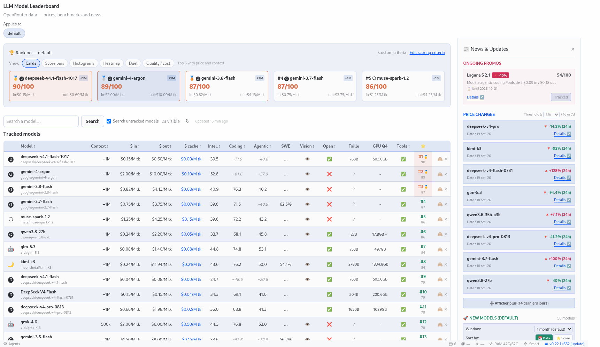 | 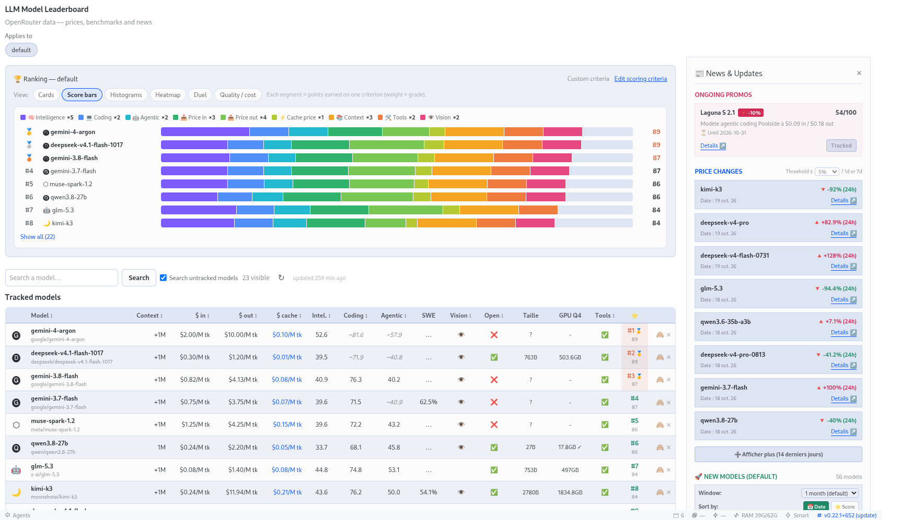 |
| **Histograms** (grade × weight) | **Heatmap** (grades 0–100, provenance on click) |
| 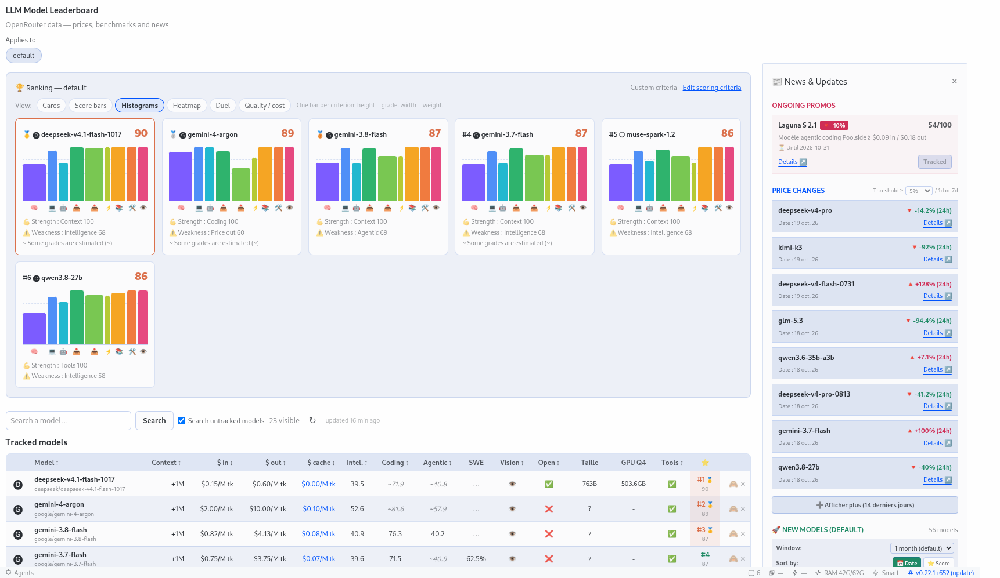 | 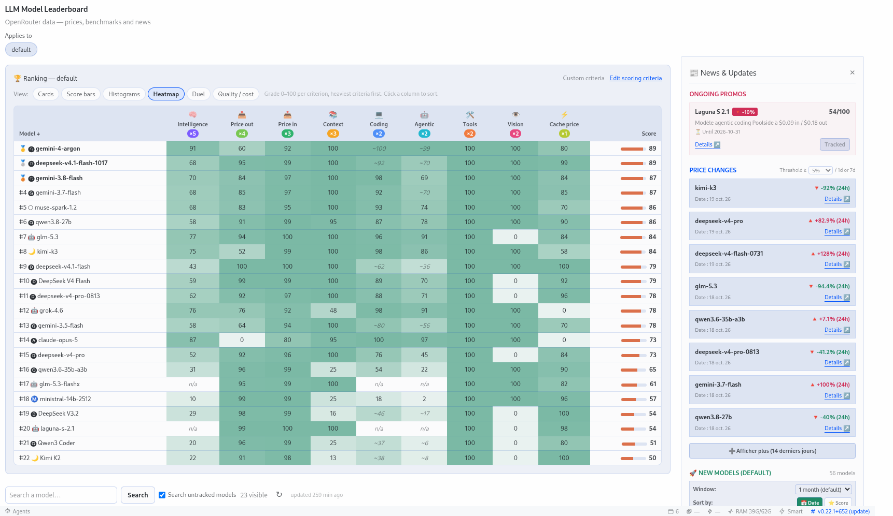 |
| **Quality / cost** (Pareto frontier) | **The table** (23 tracked models) |
| 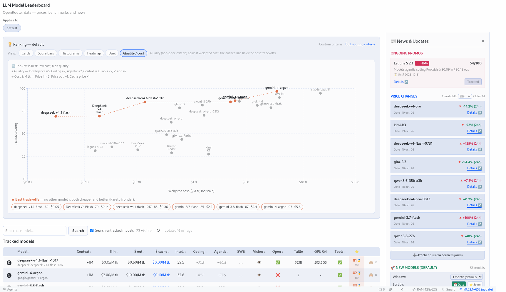 | 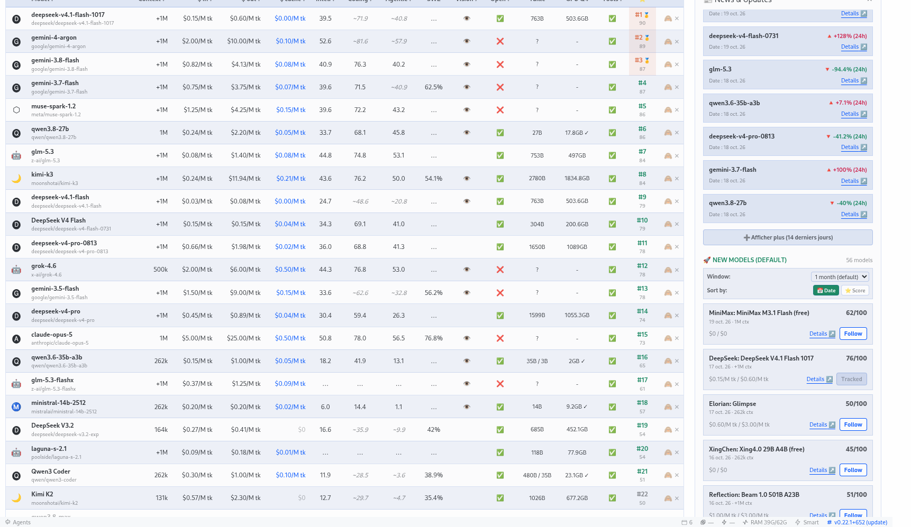 |
| **Tracking profile** (weights + Auto-fill) | **…and the same profile, re-weighted** |
| 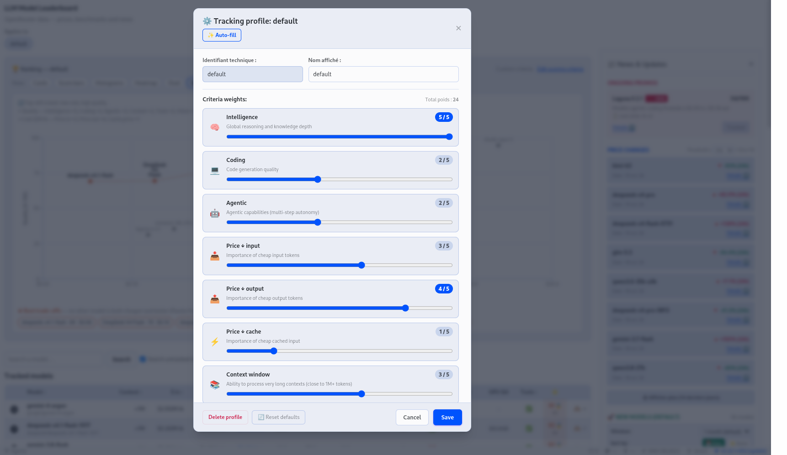 | 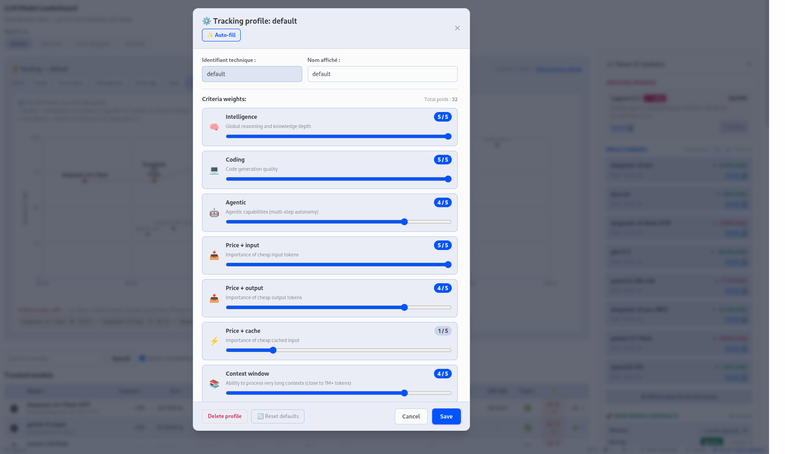 |

**Applying those criteria re-ranks the page** — the capture run moves Coding to 5, Agentic
to 4, the price weights to 5/4 and the context window to 4, saves, and photographs the
result: the cheap coding models climb (`deepseek-v4-flash-1.1`, `glm-5.3`) while the
expensive ones drop. The profile is handed back untouched at the end of the run.

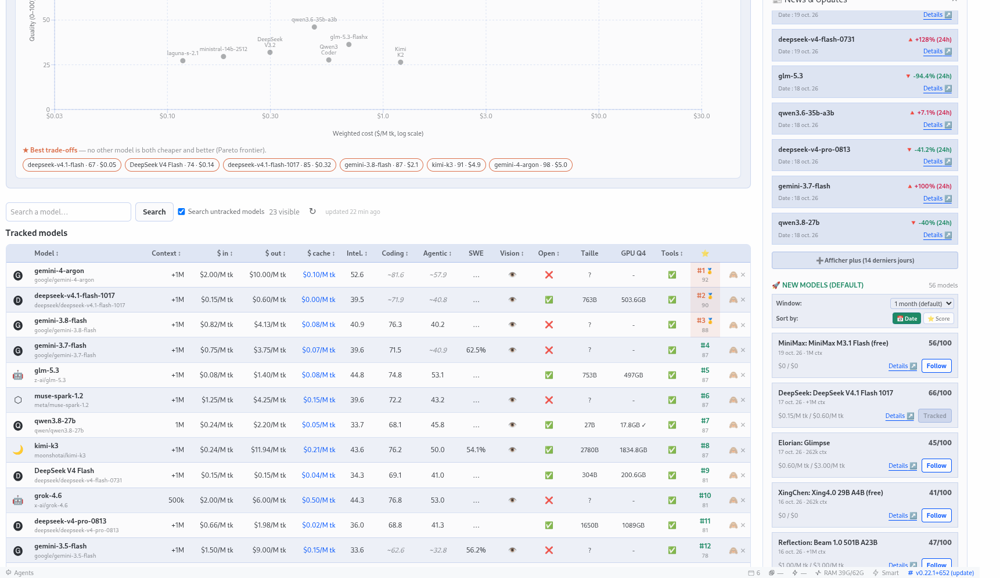

**Scoring is per profile** — the chip row is the list of *installed Hermes profiles*, and
each one keeps its own criteria. The capture run creates `front-designer`, `reviewer` and
`backend` (real profiles, removed at the end of the run), gives them opposed weights, and
photographs the same models ranked for two different jobs:

| **Front-end designer** — coding 5, vision 5 | **Reviewer** — intelligence 5, context 5 |
|:---:|:---:|
| 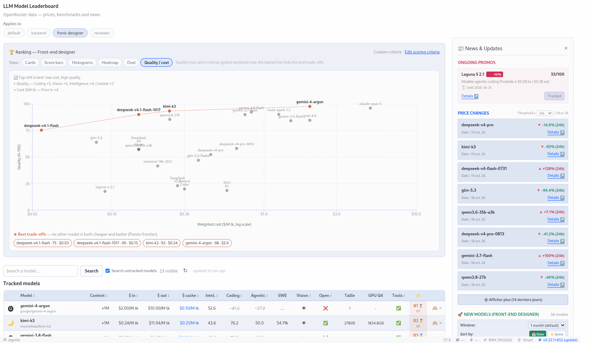 | 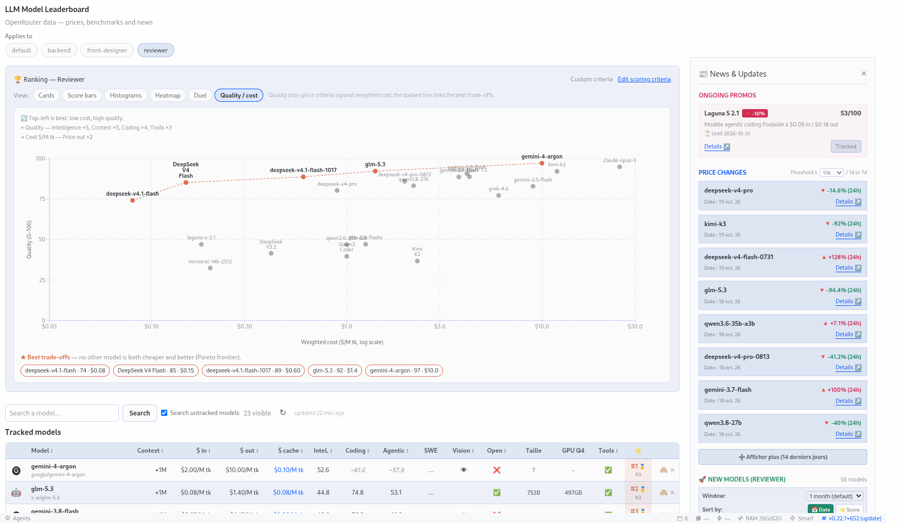 |

Navigation scenario — score views, the tracked table, the criteria dialog opened, edited
and applied, then the profile chips re-ranking the page:

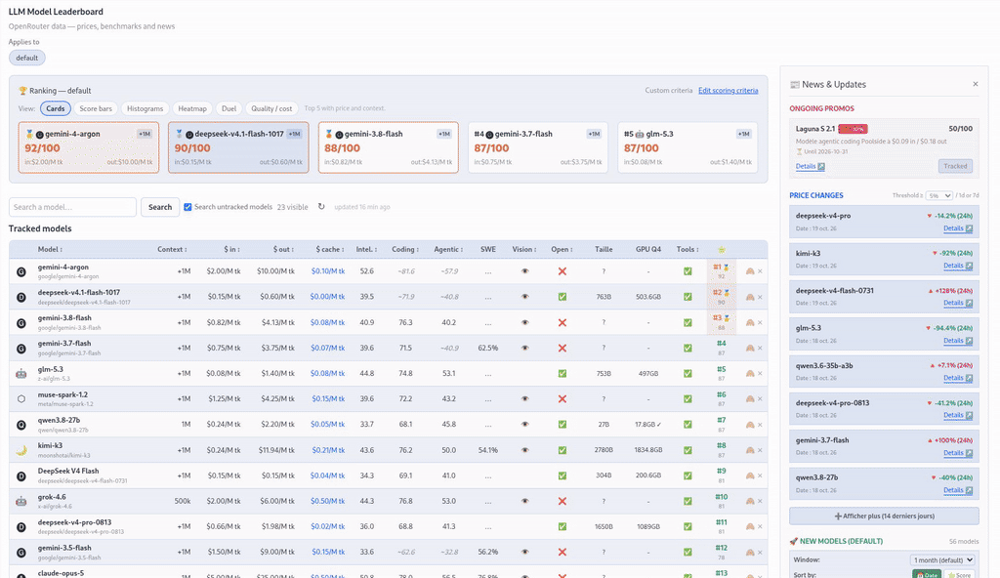

Regenerate them (the debug port is gated, hence the platform flag):

```
pkill -f 'release/linux-unpacked/Hermes'
~/.hermes/hermes-agent/apps/desktop/release/linux-unpacked/Hermes \
    --ozone-platform=wayland --remote-debugging-port=9222
python3 scripts/shots.py          # --no-gif to skip the animation, --keep-open to leave the page up
```

### Catalogue card

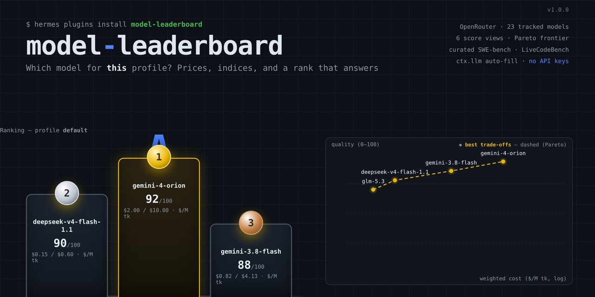

Drawn in HTML/CSS and rasterised with the Chromium Hermes ships (`scripts/card.py`), same
as [hermes-kanban-gantt](https://github.com/e-is/hermes-kanban-gantt)'s card — no image
model, no desktop, no CDP port:

```
python3 scripts/card.py --variant podium     # podium | podium-light | bars | scatter
python3 scripts/card.py --all                # every alternative + assets/card-alternatives.html
```

## License

GPL-3.0 — see [LICENSE](LICENSE).
